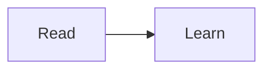

This neutral page verifies the inherited sidebar, navigation, fonts, icons, and light/dark palettes. [Return to the redesigned homepage]({{ '/' | relative_url }}).

## Contents



## Compatible writing

Both interfaces use the same Markdown files, configuration, and content collections.

## Math and visualization

$$a^2 + b^2 = c^2$$



```plotly
{"data":[{"x":[1,2],"y":[1,2],"type":"scatter"}],"layout":{"title":{"text":"Classic example"}}}
```
